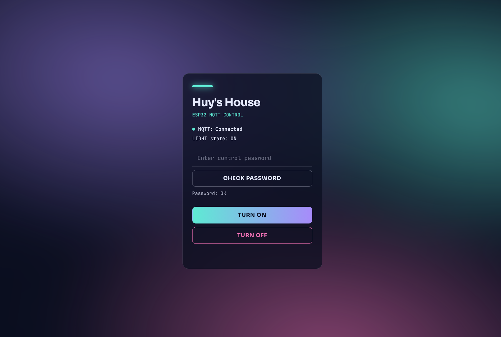
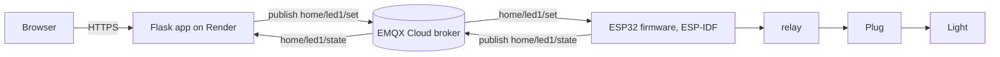

# ESP32 MQTT Web Control


Switch a plug-in lamp from a web page. A Flask app on Render publishes commands over MQTT (EMQX Cloud), an ESP32 receives them and drives a relay, and the relay switches a mains socket.

This is a personal learning project. The idea is a small DIY smart plug: any lamp with a normal plug (no smart bulb needed) goes into the socket, and the ESP32 decides when the socket has power. To test the whole chain safely before touching mains voltage, the first version drives an LED instead of a socket. The mains hardware is the next step and is described in [Smart plug hardware](#smart-plug-hardware-design).

## Live demo

**https://esp32-mqtt-web-control.onrender.com**

- The app runs on Render's free tier, so it sleeps after a while without traffic. The first load can take around a minute.
- This page currently requires a password to access.


## UI Preview



## How it works



| Topic | Direction | Payload |
|---|---|---|
| `home/led1/set` | web app → ESP32 | `ON` or `OFF` |
| `home/led1/state` | ESP32 → web app | `ON` or `OFF` (what the device actually did) |

The page shows the state the ESP32 reports, not the command that was sent, so it stays `UNKNOWN` until the first state message arrives. Publishing the state with the retain flag lets the web app pick it up right after a restart.

## Tech stack

- **Web app:** Python, Flask, gunicorn, `paho-mqtt` 2.x
- **Broker:** EMQX Cloud, MQTT over TLS (port 8883)
- **Firmware:** ESP32, ESP-IDF
- **Hosting:** Render

## Repository structure

```
.
├── main/
│   ├── blink_example_main.c
│   ├── CMakeLists.txt
│   ├── idf_component.yml
│   └── Kconfig.projbuild
├── web_dashboard/
│   ├── templates/
│   │   └── index.html
│   ├── app.py
│   └── requirements.txt
├── CMakeLists.txt
├── pytest_blink.py
├── README.md
.

```


## API

| Method | Path | Description |
|---|---|---|
| `GET` | `/` | Web UI |
| `GET` | `/health` | Health check, returns `{"status": "ok"}` |
| `GET` | `/api/state` | `{"led": "ON \| OFF \| UNKNOWN", "mqtt_connected": true, ...}` |
| `POST` | `/api/led/ON` or `/api/led/OFF` | Publish a command. Returns `503` if the broker is not connected |

### Design Overview

> [!WARNING]
> This part involves 220 V mains voltage, which can kill. It is a learning project, not a certified product. 


- **Power input/output:** 2-pin power plug and standalone 3-outlet socket.
- **Control:** ESP32 and dual-relay module for remote ON/OFF control.
- **Safety:** Fuse protection and insulated enclosure.
- **Target load:** Small loads such as lamps, subject to verified component ratings.

<!-- TODO: add the wiring diagram, e.g. docs/wiring.svg -->

| Part | Notes |
|---|---|
| ESP32 DevKit | 3.3 V logic, powered from 5 V |
| 2-channel 5 V relay module | Opto-isolated, SRD-05VDC type, rated 10 A / 250 VAC |
| Fuse and holder | 10 A |
| 2-pin power cord | Standard 2-prong plug |
| 3-outlet socket | Standalone 3-hole power socket |

### Challenges

- **Instability:** The cheap plug may be causing unstable operation. For example, electricity is still present at the output even when the relay and ESP32 are off.
- **Wi-Fi setup for ESP32:** The Wi-Fi SSID and password are hardcoded in the firmware, and I haven't built an application that allows users to configure them directly.
- **Render free tier:** When the service goes to sleep, the MQTT connection is lost. The first request wakes the service up again.