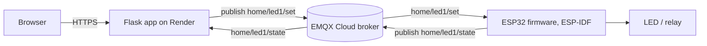

# ESP32 MQTT Web Control


Switch a plug-in lamp from a web page. A Flask app on Render publishes commands over MQTT (EMQX Cloud), an ESP32 receives them and drives a relay, and the relay switches a mains socket.

This is a personal learning project. The idea is a small DIY smart plug: any lamp with a normal plug (no smart bulb needed) goes into the socket, and the ESP32 decides when the socket has power. To test the whole chain safely before touching mains voltage, the first version drives an LED instead of a socket. The mains hardware is the next step and is described in [Smart plug hardware](#smart-plug-hardware-design).

## Live demo

**https://esp32-mqtt-web-control.onrender.com**

- The app runs on Render's free tier, so it sleeps after a while without traffic. The first load can take around a minute.
- The page has no login. That is fine for an LED, but it must be fixed before this controls anything on mains (see [Roadmap](#roadmap)).

<!-- TODO: add a short demo GIF/MP4 here, e.g. docs/demo.gif -->
<!-- TODO: add 1-2 screenshots of the web UI, e.g. docs/ui.png -->

## How it works



| Topic | Direction | Payload |
|---|---|---|
| `home/led1/set` | web app → ESP32 | `ON` or `OFF` |
| `home/led1/state` | ESP32 → web app | `ON` or `OFF` (what the device actually did) |

The page shows the state the ESP32 reports, not the command that was sent, so it stays `UNKNOWN` until the first state message arrives. Publishing the state with the retain flag lets the web app pick it up right after a restart.

## Tech stack

- **Web app:** Python, Flask, gunicorn, `paho-mqtt` 2.x
- **Broker:** EMQX Cloud, MQTT over TLS (port 8883)
- **Firmware:** ESP32, ESP-IDF
- **Hosting:** Render

## Repository structure

```
.
├── main/
│   ├── blink_example_main.c
│   ├── CMakeLists.txt
│   ├── idf_component.yml
│   └── Kconfig.projbuild
├── web_dashboard/
│   ├── templates/
│   │   └── index.html
│   ├── app.py
│   └── requirements.txt
├── CMakeLists.txt
├── pytest_blink.py
├── README.md
.

```

## Getting started

### 1. MQTT broker

Create a deployment on EMQX Cloud, add an authentication user, and note the host name. The app connects over TLS on port 8883. Every client needs a **unique client ID**, otherwise the broker keeps kicking the older connection (see [Things I ran into](#things-i-ran-into)).

### 2. Run the web app locally

```bash
git clone <your-repo-url>
cd <your-repo-folder>

python -m venv .venv
source .venv/bin/activate        # Windows: .venv\Scripts\activate
pip install -r requirements.txt
```

Create a file named `PASS.env` next to `app.py`:

```env
MQTT_HOST=your-broker-host.emqxsl.com
MQTT_PORT=8883
MQTT_USER=your-username
MQTT_PASSWORD=your-password
MQTT_TLS=true
```

Then run:

```bash
python app.py
```

Open http://localhost:5000. `PASS.env` holds your broker credentials, so make sure it is listed in `.gitignore` and never committed.

| Variable | Required | Description |
|---|---|---|
| `MQTT_HOST` | yes | Broker host name |
| `MQTT_PORT` | no | Default `8883` |
| `MQTT_USER`, `MQTT_PASSWORD` | yes | Broker credentials |
| `MQTT_TLS` | no | Default `true` |
| `MQTT_ENV` | no | Label put in the client ID (`local`, `render`, ...) |
| `MQTT_DEBUG` | no | `true` prints every paho log line |

### 3. Deploy to Render

Create a Web Service from the repo and set:

- **Build command:** `pip install -r requirements.txt`
- **Start command:** `gunicorn --workers 1 --threads 4 --bind 0.0.0.0:$PORT app:app`
- **Environment:** the variables above, plus `MQTT_ENV=render` and `PYTHONUNBUFFERED=1`

Use a single worker: each worker process opens its own MQTT connection.

### 4. Flash the ESP32

The firmware is an ESP-IDF project in `firmware/`. Set your Wi-Fi and MQTT credentials (menuconfig or your own config file), then:

```bash
cd firmware
idf.py set-target esp32
idf.py build flash monitor
```

<!-- TODO: add the ESP-IDF version used, and how Wi-Fi/MQTT credentials are configured -->

## API

| Method | Path | Description |
|---|---|---|
| `GET` | `/` | Web UI |
| `GET` | `/health` | Health check, returns `{"status": "ok"}` |
| `GET` | `/api/state` | `{"led": "ON \| OFF \| UNKNOWN", "mqtt_connected": true, ...}` |
| `POST` | `/api/led/ON` or `/api/led/OFF` | Publish a command. Returns `503` if the broker is not connected |

## Smart plug hardware (design)

> [!WARNING]
> This part involves 220 V mains voltage, which can kill. It is a learning project, not a certified product. Work with the plug pulled out of the wall, use an insulated enclosure, and have someone with electrical experience review the build before using it long term.

The plug build is at the design stage and has not been built yet. The design choices:

- **2-pin, non-polarized plug.** The plug can go in either way, so neither wire can be assumed to be live.
- **Both conductors are switched.** A 2-channel relay module is used as a double-pole switch: relay 1 on one wire, relay 2 on the other, always driven together.
- **Manual override.** A 2-pole, 3-position ON-OFF-ON rocker switch. `ON` bypasses the relays, `OFF` cuts both wires, `AUTO` lets the ESP32 decide. The socket still works if the ESP32 fails.
- **Protection.** 10 A fuse, isolated 5 V supply, fully insulated enclosure (there is no earth wire, so no exposed metal).
- **Intended loads.** Small resistive loads such as lamps, about 5 A per relay at most. Not for motors or compressors.

<!-- TODO: add the wiring diagram, e.g. docs/wiring.svg -->

| Part | Notes |
|---|---|
| ESP32 DevKit | 3.3 V logic, powered from 5 V |
| 2-channel 5 V relay module | Opto-isolated, SRD-05VDC type, rated 10 A / 250 VAC |
| Isolated 5 V supply | HLK-PM01 inside the enclosure, or a certified external adapter |
| DPDT ON-OFF-ON rocker switch | 6 pins, 16 A 250 VAC |
| Fuse and holder | 10 A |
| 2-pin plug cord and 2-pin socket | Rated for the load |
| Insulated enclosure | ABS, fixed lid, cable strain relief |

## Things I ran into

- **Duplicate client ID.** With a fixed MQTT client ID, a second copy of the app (for example the local one and the Render one) makes the broker disconnect the first, and both reconnect forever. Each process now adds a random suffix to its client ID.
- **Threads and gunicorn.** paho runs its network loop in a background thread, and threads do not survive `fork`. The MQTT client is created inside the worker process on its first request instead of when the module is imported.
- **Render free tier.** When the service sleeps, the MQTT connection goes with it. The first request wakes it up again.

## Roadmap

- [x] Web UI to MQTT to ESP32 control of an LED
- [x] Deployed on Render with EMQX Cloud over TLS
- [ ] Build the smart plug hardware (double-pole switching, manual override)
- [ ] Add authentication to the web UI before it controls anything on mains
- [ ] Show device online/offline using MQTT Last Will

## License

No license chosen yet.